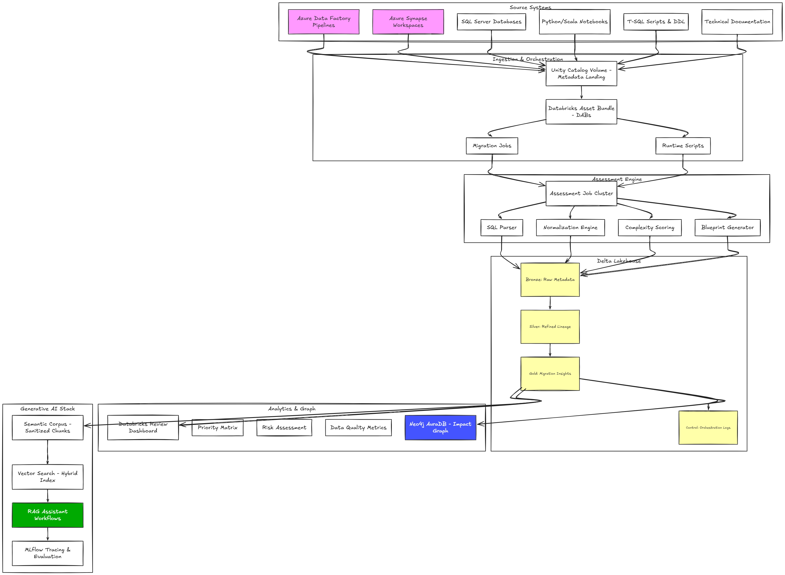
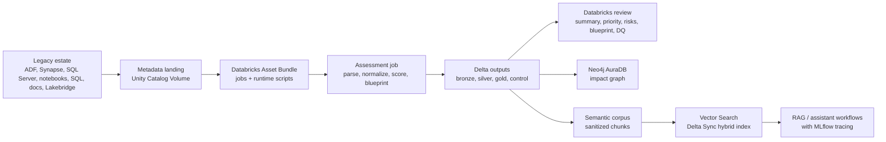

# Repository Architecture

This document explains the product architecture, the Databricks resources that are created and where each repo piece fits.

## Product Role

The repository implements a Databricks migration assessment workbench.

It runs before or during migration execution to build the inventory, dependency model, risk register, target blueprint, DQ plan, graph and semantic search layer. It does not move all production data, convert all legacy code or cut workloads over by itself.

The execution team uses the outputs to decide and implement the actual migration pattern for each asset.

## Architecture Layers



The image is the quick visual map. The Mermaid version below is the editable source view for the same layers.



### Global Platform Layer

| Platform | Role |
| --- | --- |
| Databricks | Runs the bundle, serverless jobs, Delta outputs, Unity Catalog governance, Vector Search, RAG utilities and MLflow tracking. |
| Unity Catalog | Governs the catalog, schemas, tables, volumes, vector index and optional federated connections. |
| Neo4j AuraDB | Graph exploration for migration impact analysis. Delta remains the assessment source of truth. |
| SQL Server | Local Docker fixture for demo; real customer source can use export-only discovery, Lakehouse Federation or connector-based ingestion. |

### Databricks Assessment Layer

| Component | Function |
| --- | --- |
| Metadata landing volume | Stores raw exported artifacts and runtime Python scripts in governed storage. |
| Accelerator job | Parses raw artifacts, normalizes assets/dependencies, scores risk and writes Delta outputs. |
| Target demo job | Consumes the generated blueprint and creates a simple target migration plan table. It is not production data movement. |
| Semantic prep job | Creates sanitized chunks from legacy artifacts and generated outputs for Vector Search. |
| Vector Search index | Provides semantic and hybrid retrieval over the migration estate. |

### Advanced AI Layer

| Component | Function |
| --- | --- |
| Embedding model endpoint | Converts `chunk_text` into vectors. Dev uses `databricks-qwen3-embedding-0-6b`. |
| Vector Search endpoint | Serves the vector index for retrieval queries. Dev uses `mma-vector-search-dev`. |
| Foundation Model chat endpoint | Generates optional grounded answers from retrieved evidence. Dev uses `databricks-gemma-3-12b`. |
| RAG/search workflow | Retrieves relevant chunks, writes a grounded brief and can generate an LLM answer with `-GenerateAnswer`. |
| MLflow | Logs retrieval, generation artifacts and manual trace spans; scorer-based evaluation is the next hardening layer. |
| Model Serving / AI Gateway | Future interactive serving layer if the accelerator exposes an assistant endpoint. |

## Databricks UI Map

Use this map when validating the workspace manually.

| What to inspect | Where in Databricks UI | Expected dev object |
| --- | --- | --- |
| Bundle jobs | `Jobs & Pipelines` | `modern_migration_accelerator_databricks-dev-accelerator`, `...-target-demo`, `...-semantic-index-prep` |
| Delta outputs | `Catalog` > `migration_accelerator_dev` | Schemas `bronze`, `silver`, `gold`, `control`, `demo` |
| Metadata volume | `Catalog` > `migration_accelerator_dev` > `landing` | Volume `legacy_metadata` |
| Source table for semantic search | `Catalog` > `migration_accelerator_dev` > `gold` | Table `semantic_legacy_documents` |
| Vector Search index | `Catalog` search or `Catalog` > `migration_accelerator_dev` > `gold` | Managed vector index `semantic_legacy_documents_vs` |
| Vector index sync | Vector index page > `Overview` > `Data Ingest` | `Sync now` for triggered sync |
| Vector Search endpoint | CLI/API, and Vector Search index details | Endpoint `mma-vector-search-dev` |
| Embedding model endpoint | AI Gateway / Foundation Model endpoints, depending workspace UI and filters | `databricks-qwen3-embedding-0-6b` |
| Foundation Model chat endpoint | `AI/ML` > `Serving` or `AI Gateway`, depending workspace UI | `databricks-gemma-3-12b` |
| RAG/search brief | Local repo output unless MLflow logging is enabled | `local_outputs/rag/latest_answer.md`, `latest_search.json`, `latest_trace.json` |
| Generated RAG answer | Local repo output; MLflow artifact when `-LogMlflow` is enabled | `local_outputs/rag/latest_llm_answer.md`, `latest_generation.json` |
| RAG eval summary | Local repo output; MLflow artifact when `-LogMlflow` is enabled | `local_outputs/rag_eval/latest_eval.md`, `latest_eval.json` |
| MLflow starter run | `Experiments` | Experiment from `MLFLOW_EXPERIMENT_NAME`, default `/Shared/modern-migration-accelerator` |

Do not expect `mma-vector-search-dev` to appear under `AI/ML > Serving` as a normal user-created serving endpoint. Vector Search endpoints are managed separately from Model Serving endpoints. The index is visible and governed in Unity Catalog. The endpoint is easiest to verify with:

```bash
databricks --profile <profile> vector-search-endpoints get-endpoint mma-vector-search-dev
databricks --profile <profile> vector-search-indexes get-index migration_accelerator_dev.gold.semantic_legacy_documents_vs
```

If you are using PowerShell or Git Bash scripts from this repo, they load `DATABRICKS_PROFILE` from `.env`.

The current RAG/search utility is a script workflow, not a Databricks serving endpoint. It becomes visible in Databricks UI only when `-LogMlflow` is used, because the query, brief and trace JSON are then logged as MLflow artifacts.

## Databricks Resources

Default dev deployment creates or uses:

| Resource | Name or path | Purpose |
| --- | --- | --- |
| Bundle target | `dev` | Local development deployment target. |
| Catalog | `migration_accelerator_dev` | Default Unity Catalog catalog for dev outputs. |
| Volume | `/Volumes/migration_accelerator_dev/landing/legacy_metadata/` | Governed metadata landing and runtime script location. |
| Runtime scripts | `/Volumes/<catalog>/landing/legacy_metadata/runtime/` | Serverless-safe Python task entrypoints. |
| Demo metadata | `/Volumes/<catalog>/landing/legacy_metadata/demo/` | Uploaded sample artifacts plus optional local SQL Server export. |
| Job | `modern_migration_accelerator_databricks-dev-accelerator` | Parse metadata and write assessment outputs. |
| Job | `modern_migration_accelerator_databricks-dev-target-demo` | Build a demo target migration plan from the blueprint; no source data cutover. |
| Job | `modern_migration_accelerator_databricks-dev-semantic-index-prep` | Build Vector Search-ready semantic chunks. |
| Vector Search endpoint | `mma-vector-search-dev` | Serves the semantic search index. |
| Vector Search index | `migration_accelerator_dev.gold.semantic_legacy_documents_vs` | Delta Sync hybrid index over semantic chunks. |
| Embedding endpoint | `databricks-qwen3-embedding-0-6b` | Databricks-hosted embedding model used by the index. |
| Foundation Model endpoint | `databricks-gemma-3-12b` | Databricks-hosted chat model used only when `-GenerateAnswer` is passed. |
| MLflow experiment | `/Shared/modern-migration-accelerator` | Stores RAG retrieval/generation artifacts and starter traces. |

Current dev validation:

| Check | Result |
| --- | --- |
| Semantic chunks | `309` rows indexed. |
| Index readiness | `ready=true`. |
| Index type | `DELTA_SYNC`. |
| Index subtype | `HYBRID`. |
| Sync mode | `TRIGGERED`. |
| Primary key | `chunk_id`. |
| Text column | `chunk_text`. |
| ANN metric | Databricks-managed HNSW with L2 distance. |
| Query mode | `HYBRID` by default in repo scripts. |
| RAG retrieval | Validated with `rag_search_dev.ps1`. |
| Generated RAG answer | Validated with `databricks-gemma-3-12b`. |
| MLflow run | Validated in Databricks experiment `/Shared/modern-migration-accelerator`. |

Databricks also creates internal service resources for Vector Search, such as a Delta Sync pipeline ID. Those IDs are workspace-generated and should not be hardcoded in the repo.

Credit guardrails:

- Vector Search creation, index sync and Foundation Model calls consume Databricks trial credits.
- Retrieval-only RAG is cheaper than generated-answer mode because it does not call a chat model.
- Use `-GenerateAnswer` for final validation, screenshots and demos; avoid loops over many questions until a usage budget exists.
- Keep `RAG_LLM_MAX_TOKENS` controlled for dev. Default is `1200`.

## Bundle Structure

| Path | Purpose |
| --- | --- |
| `databricks.yml` | Bundle name, target and variables such as catalog and metadata source root. |
| `resources/jobs.yml` | Databricks jobs: assessment, target demo and semantic index prep. |
| `samples/legacy_metadata/` | Demo estate used for the first run. |
| `samples/sqlserver/` | Local SQL Server fixture, seed data and metadata extraction query. |
| `contracts/` | Customer intake checklist, inventory CSV contract and metadata taxonomy. |
| `scripts/validate_bundle.sh` | Validate bundle configuration before deploy. |
| `scripts/deploy_dev.sh` | Upload runtime scripts, prepare the volume and deploy jobs. |
| `scripts/run_accelerator_dev.sh` | Run the assessment job. |
| `scripts/run_target_demo_dev.sh` | Run the blueprint consumer demo job. |
| `scripts/run_semantic_index_prep_dev.sh` | Run the semantic corpus preparation job. |
| `scripts/create_vector_search_dev.*` | Create/sync the dev Vector Search endpoint and index. |
| `scripts/query_vector_search_dev.*` | Query the Vector Search index with a natural-language question. |
| `scripts/rag_search_dev.*` | Query Vector Search, build a grounded retrieval brief, optionally call a Foundation Model and optionally log to MLflow. |
| `scripts/rag_eval_dev.*` | Run a small RAG retrieval/generation evaluation set. |
| `scripts/publish_neo4j_graph.*` | Publish the normalized asset and dependency graph to Neo4j AuraDB. |
| `scripts/verify_neo4j_graph.*` | Verify the latest Neo4j graph publication. |
| `scripts/query_sqlserver_fixture.*` | Inspect the local SQL Server fixture without SSMS. |
| `src/modern_migration_accelerator/pipelines/run_accelerator.py` | Serverless-safe assessment entrypoint. |
| `src/modern_migration_accelerator/pipelines/run_target_demo.py` | Demo consumer of the generated blueprint. |
| `src/modern_migration_accelerator/pipelines/run_semantic_index_prep.py` | Builds sanitized chunks from legacy artifacts and generated outputs. |
| `src/modern_migration_accelerator/xlsx.py` | Reads Lakebridge Analyzer `.xlsx` reports without adding external dependencies. |
| `src/modern_migration_accelerator/rag_search.py` | Vector Search retrieval, grounded brief generation, optional LLM answer and MLflow logging. |
| `src/modern_migration_accelerator/rag_eval.py` | Lightweight RAG evaluation over expected terms/assets. |
| `src/modern_migration_accelerator/neo4j_graph.py` | Builds and publishes the Neo4j graph payload. |

## Extractor Map

In this project, an extractor means code that turns customer-provided artifacts into normalized assets and dependencies. The first implementation is intentionally compact; richer customer patterns can be added without changing the product flow.

| Area | Current implementation | Function |
| --- | --- | --- |
| Source file discovery | `src/modern_migration_accelerator/discovery.py`, `run_accelerator.py::load_text_documents` | Finds supported `.json`, `.csv`, `.sql`, `.ipynb` and `.xlsx` files locally or in Unity Catalog volumes. |
| ADF JSON parsing | `run_accelerator.py::parse_adf_document`, `parse_adf_dataset_resource`, `parse_adf_linked_service_resource`, `parse_adf_trigger_resource` | Extracts pipelines, activities, datasets, linked services, triggers and references. |
| Synapse and SQL Server inventory CSV | `run_accelerator.py::parse_synapse_csv` | Converts inventory rows into assets for Synapse, SQL Server and similar tabular metadata exports. |
| SQL scripts and DDL | `run_accelerator.py::parse_sql_document`, `src/modern_migration_accelerator/parsers/sql.py` | Extracts SQL object references from scripts, views, procedures and external table DDL. |
| Notebooks | `run_accelerator.py::parse_notebook_document` | Reads notebook cells and extracts SQL/table references. |
| Lakebridge Analyzer | `run_accelerator.py::parse_lakebridge_analyzer_document`, `src/modern_migration_accelerator/xlsx.py` | Converts Analyzer `.xlsx` reports into SQL program assets, referenced objects and read/write dependencies. |
| Semantic corpus | `run_semantic_index_prep.py` | Sanitizes, chunks and shapes searchable documents for Vector Search. |
| SQL Server export fixture | `scripts/export_sqlserver_metadata.*`, `samples/sqlserver/extract/metadata_inventory.sql` | Produces a CSV inventory from SQL Server metadata. |

Improving extractors usually means adding support for more real-world source shapes: parameterized ADF expressions, nested activity patterns, customer naming conventions, stored procedure dependencies, Purview exports, Synapse workspace exports or additional SQL dialects. It is usually low to moderate effort when the artifact format is stable and sample files are available. It becomes harder when dependencies only appear at runtime, inside dynamic strings, inside custom frameworks or behind restricted source access.

## Runtime Responsibility Map

| Command or job | Main code | Engine | Output | Where to inspect |
| --- | --- | --- | --- | --- |
| `setup_dev_env.*` | `scripts/setup_dev_env.*` | Local Python/pip | `.venv` dependencies | Local terminal |
| `run_accelerator_dev.sh` | `run_accelerator.py` | Databricks Workflows, serverless Spark | `bronze`, `silver`, `gold`, `control` tables | Databricks `Catalog` |
| Risk and priority generation | `build_risk_register()`, `build_asset_priority_matrix()` | Python/Spark job logic | `gold.risk_register`, `gold.asset_priority_matrix` | Databricks `Catalog` |
| `run_semantic_index_prep_dev.sh` | `run_semantic_index_prep.py` | Databricks Workflows, serverless Spark | `gold.semantic_legacy_documents` | Databricks `Catalog` |
| `create_vector_search_dev.*` | `scripts/create_vector_search_dev.*` | Databricks Vector Search | endpoint and index | Databricks `Catalog`, CLI/API |
| `rag_search_dev.*` | `src/modern_migration_accelerator/rag_search.py` | Local Python plus Databricks Vector Search API | `local_outputs/rag/*` | Local files; MLflow if `-LogMlflow` |
| `rag_search_dev.* -GenerateAnswer` | `rag_search.py::invoke_chat_endpoint()` | Databricks Foundation Model API chat endpoint | `latest_generation.json`, `latest_llm_answer.md` | Local files; Databricks `Serving`; MLflow artifacts |
| `rag_search_dev.* -LogMlflow` | `rag_search.py::log_to_mlflow()` | MLflow Tracking | run params, metric and artifacts | Databricks `Experiments` |
| `rag_eval_dev.*` | `src/modern_migration_accelerator/rag_eval.py` | Local Python plus Vector Search, optional Foundation Model | `local_outputs/rag_eval/*` | Local files; MLflow if `-LogMlflow` |
| `publish_neo4j_graph.*` | `neo4j_graph.py` | Local Python plus Neo4j driver | graph nodes and relationships | Neo4j Aura Query/Explore |

## Execution Order

1. Configure `.env`.
2. Run local smoke tests.
3. Optional: start SQL Server fixture and export metadata.
4. Validate the Databricks bundle.
5. Deploy the dev bundle.
6. Run the accelerator.
7. Review gold and control tables.
8. Run the target demo.
9. Prepare semantic chunks.
10. Create and query the Vector Search index.
11. Build a RAG-ready retrieval brief from Vector Search.
12. Optionally generate a grounded LLM answer and log it to MLflow.
13. Run the starter RAG evaluation set.
14. Publish to Neo4j.
15. Add scorer-based GenAI evaluation and serving after retrieval behavior is trusted.

## Metadata Modes

Demo mode:

- Leave `LEGACY_METADATA_SOURCE_ROOT` empty.
- `scripts/run_accelerator_dev.sh` uploads `samples/legacy_metadata` to `/Volumes/<catalog>/landing/legacy_metadata/demo`.
- If `local_outputs/legacy_metadata` exists, it is uploaded into the same demo root.

Customer mode:

- Put customer exports in `/Volumes/<catalog>/landing/legacy_metadata/`.
- Set `LEGACY_METADATA_SOURCE_ROOT` to that path.
- Run the same bundle commands.

The customer does not need an existing metadata framework. The accelerator creates the normalized metadata model from raw exports.

## Output Model

| Layer | Tables |
| --- | --- |
| `control` | `run_log`, `metadata_snapshots` |
| `bronze` | `raw_metadata` |
| `silver` | `assets`, `dependencies` |
| `gold` | `assessment_summary`, `asset_priority_matrix`, `graph_edges`, `risk_register`, `target_databricks_blueprint`, `data_quality_plan`, `semantic_legacy_documents` |
| `demo` | `target_migration_plan` |

Read results in this order:

1. `gold.assessment_summary`
2. `gold.asset_priority_matrix`
3. `gold.graph_edges`
4. `gold.risk_register`
5. `gold.target_databricks_blueprint`
6. `gold.data_quality_plan`
7. `gold.semantic_legacy_documents`
8. `migration_accelerator_dev.gold.semantic_legacy_documents_vs`

## Product State

Confirmed working:

- Local SQL Server fixture, data inspection and metadata export.
- Lakebridge Analyzer `.xlsx` parsing against the reference lab report.
- Databricks bundle validation, deployment and serverless jobs.
- Delta assessment outputs.
- Target demo table creation.
- Neo4j AuraDB graph publishing and verification.
- Semantic chunk table generation.
- Databricks Vector Search endpoint, Delta Sync hybrid index and query scripts.
- RAG-ready search utility that writes local evidence, answer brief and trace JSON.
- Foundation Model grounded answer generation with `databricks-gemma-3-12b`.
- Databricks MLflow experiment logging for retrieval, generation artifacts and manual trace spans.
- Starter RAG evaluation harness over expected terms/assets.

Remaining product hardening:

- Replace lightweight eval matching with scorer-based GenAI quality checks when customer-quality expected answers exist.
- Package the RAG workflow behind Model Serving or AI Gateway if an interactive assistant is required.
- Add Databricks secret scope setup for enterprise credentials.
- Add customer-specific CI/CD only when the target toolchain is known.
- Add richer source-specific extractors as real customer artifacts reveal gaps.
