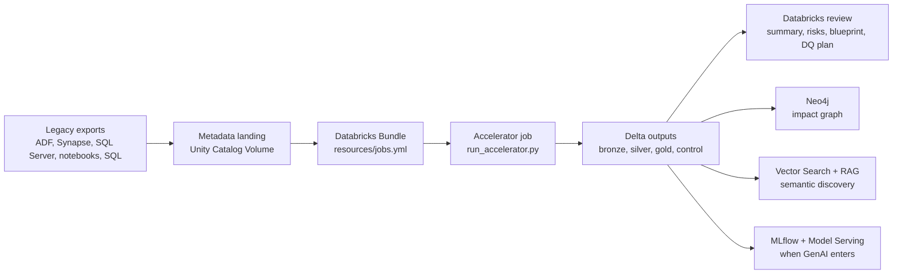

# Repository Architecture

This document explains where the main pieces live and how they work together.

## Flow

## Main Pieces

| Path | Purpose |
| --- | --- |
| `databricks.yml` | Bundle name, target and variables such as catalog and metadata source root. |
| `resources/jobs.yml` | Databricks jobs. The accelerator job parses metadata and writes Delta outputs. The target demo job creates a small table from the blueprint. |
| `samples/legacy_metadata/` | Demo estate used for the first run. |
| `samples/sqlserver/` | Local SQL Server fixture and metadata extraction query. |
| `scripts/` | Local setup, preflight, bundle validation, deploy, run and connectivity helpers. |
| `src/modern_migration_accelerator/pipelines/run_accelerator.py` | Serverless-safe accelerator entrypoint. It loads text metadata, normalizes assets, builds dependencies, risks, blueprint, DQ plan and graph edges. |
| `src/modern_migration_accelerator/pipelines/run_target_demo.py` | Demo consumer of the generated blueprint. |
| `contracts/` | Customer intake checklist, inventory CSV contract and metadata taxonomy. |
| `docs/` | Product positioning, implementation guide, first-run runbook and advanced capability plan. |

## Execution Order

1. Configure `.env`.
2. Run local smoke tests.
3. Validate the Databricks bundle.
4. Deploy the dev bundle.
5. Run the accelerator.
6. Review gold and control tables.
7. Run the target demo.
8. Publish to Neo4j, Vector Search and MLflow-backed workflows after Delta outputs are trusted.

## Metadata Modes

Demo mode:

- Leave `LEGACY_METADATA_SOURCE_ROOT` empty.
- `scripts/run_accelerator_dev.sh` uploads `samples/legacy_metadata` to `/Volumes/<catalog>/landing/legacy_metadata/demo`.
- Runtime scripts are uploaded to `/Volumes/<catalog>/landing/legacy_metadata/runtime`.

Customer mode:

- Put customer exports in `/Volumes/<catalog>/landing/legacy_metadata/`.
- Set `LEGACY_METADATA_SOURCE_ROOT` to that path.
- Run the same bundle commands.

The repo does not require the customer to already have a metadata framework. The accelerator creates the normalized metadata model from raw exports.

## Output Model

| Layer | Tables |
| --- | --- |
| `control` | `run_log`, `metadata_snapshots` |
| `bronze` | `raw_metadata` |
| `silver` | `assets`, `dependencies` |
| `gold` | `assessment_summary`, `asset_priority_matrix`, `graph_edges`, `risk_register`, `target_databricks_blueprint`, `data_quality_plan` |
| `demo` | `target_migration_plan` |

Read `gold.assessment_summary` first, then `gold.asset_priority_matrix`, then `gold.graph_edges`, `gold.risk_register`, `gold.target_databricks_blueprint` and `gold.data_quality_plan`.
