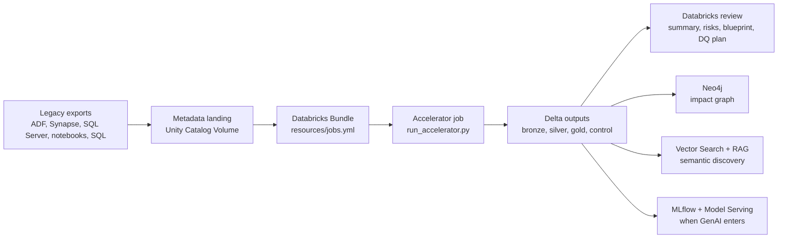

# Repository Architecture

This document explains where the main pieces live and how they work together.

## Flow

## Main Pieces

| Path | Purpose |
| --- | --- |
| `databricks.yml` | Bundle name, target and variables such as catalog and metadata source root. |
| `resources/jobs.yml` | Databricks jobs. The accelerator job parses metadata and writes Delta outputs. The target demo job creates a small table from the blueprint. |
| `samples/legacy_metadata/` | Demo estate used for the first run. |
| `samples/sqlserver/` | Local SQL Server fixture and metadata extraction query. |
| `scripts/` | Local setup, preflight, bundle validation, deploy, run and connectivity helpers. |
| `scripts/publish_neo4j_graph.*` | Publishes the normalized asset and dependency graph to Neo4j AuraDB. |
| `scripts/verify_neo4j_graph.*` | Verifies the latest Neo4j graph publication. |
| `scripts/run_semantic_index_prep_dev.sh` | Runs the Databricks job that creates the Vector Search-ready semantic corpus. |
| `scripts/create_vector_search_dev.*` | Creates the dev Vector Search endpoint and Delta Sync index. |
| `scripts/query_vector_search_dev.*` | Queries the Vector Search index with a natural-language question. |
| `scripts/query_sqlserver_fixture.*` | Inspects the local SQL Server fixture without SSMS. |
| `src/modern_migration_accelerator/pipelines/run_accelerator.py` | Serverless-safe accelerator entrypoint. It loads text metadata, normalizes assets, builds dependencies, risks, blueprint, DQ plan and graph edges. |
| `src/modern_migration_accelerator/pipelines/run_semantic_index_prep.py` | Builds sanitized chunks from legacy artifacts and generated outputs for Vector Search. |
| `src/modern_migration_accelerator/neo4j_graph.py` | Builds and publishes the Neo4j graph payload. |
| `src/modern_migration_accelerator/pipelines/run_target_demo.py` | Demo consumer of the generated blueprint. |
| `contracts/` | Customer intake checklist, inventory CSV contract and metadata taxonomy. |
| `docs/` | Product positioning, implementation guide, first-run runbook and advanced capability plan. |

## Databricks Resources

Default dev deployment creates or uses:

| Resource | Name or path | Purpose |
| --- | --- | --- |
| Bundle target | `dev` | Local development deployment target. |
| Jobs | `modern_migration_accelerator_databricks-dev-accelerator` | Parse metadata and write assessment outputs. |
| Jobs | `modern_migration_accelerator_databricks-dev-target-demo` | Build a demo target migration plan from the blueprint. |
| Jobs | `modern_migration_accelerator_databricks-dev-semantic-index-prep` | Build Vector Search-ready semantic chunks. |
| Catalog | `migration_accelerator_dev` | Default Unity Catalog catalog for dev outputs. |
| Volume | `/Volumes/migration_accelerator_dev/landing/legacy_metadata/` | Governed metadata landing and runtime script location. |
| Runtime scripts | `/Volumes/<catalog>/landing/legacy_metadata/runtime/` | Serverless-safe Python task entrypoints. |
| Demo metadata | `/Volumes/<catalog>/landing/legacy_metadata/demo/` | Uploaded sample artifacts plus optional local SQL Server export. |
| Vector Search endpoint | `mma-vector-search-dev` | Dev endpoint for semantic search. |
| Vector Search index | `migration_accelerator_dev.gold.semantic_legacy_documents_vs` | Delta Sync hybrid index over semantic chunks. |
| Embedding endpoint | `databricks-qwen3-embedding-0-6b` | Databricks-hosted embedding model used by the index. |

## Execution Order

1. Configure `.env`.
2. Run local smoke tests.
3. Validate the Databricks bundle.
4. Deploy the dev bundle.
5. Run the accelerator.
6. Review gold and control tables.
7. Run the target demo.
8. Prepare semantic chunks for Vector Search.
9. Create and query the Vector Search index.
10. Publish to Neo4j.
11. Add MLflow-backed workflows after graph and semantic retrieval outputs are trusted.

## Metadata Modes

Demo mode:

- Leave `LEGACY_METADATA_SOURCE_ROOT` empty.
- `scripts/run_accelerator_dev.sh` uploads `samples/legacy_metadata` to `/Volumes/<catalog>/landing/legacy_metadata/demo`.
- Runtime scripts are uploaded to `/Volumes/<catalog>/landing/legacy_metadata/runtime`.

Customer mode:

- Put customer exports in `/Volumes/<catalog>/landing/legacy_metadata/`.
- Set `LEGACY_METADATA_SOURCE_ROOT` to that path.
- Run the same bundle commands.

The repo does not require the customer to already have a metadata framework. The accelerator creates the normalized metadata model from raw exports.

## Output Model

| Layer | Tables |
| --- | --- |
| `control` | `run_log`, `metadata_snapshots` |
| `bronze` | `raw_metadata` |
| `silver` | `assets`, `dependencies` |
| `gold` | `assessment_summary`, `asset_priority_matrix`, `graph_edges`, `risk_register`, `target_databricks_blueprint`, `data_quality_plan`, `semantic_legacy_documents` |
| `demo` | `target_migration_plan` |

Read `gold.assessment_summary` first, then `gold.asset_priority_matrix`, then `gold.graph_edges`, `gold.risk_register`, `gold.target_databricks_blueprint`, `gold.data_quality_plan` and `gold.semantic_legacy_documents`.
